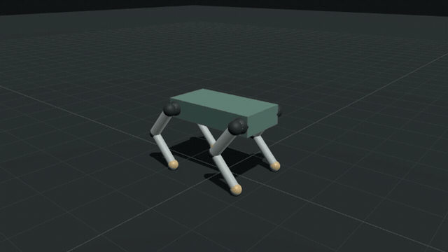
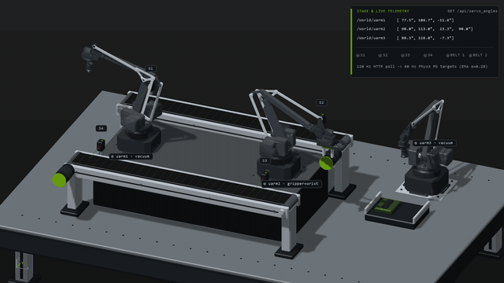
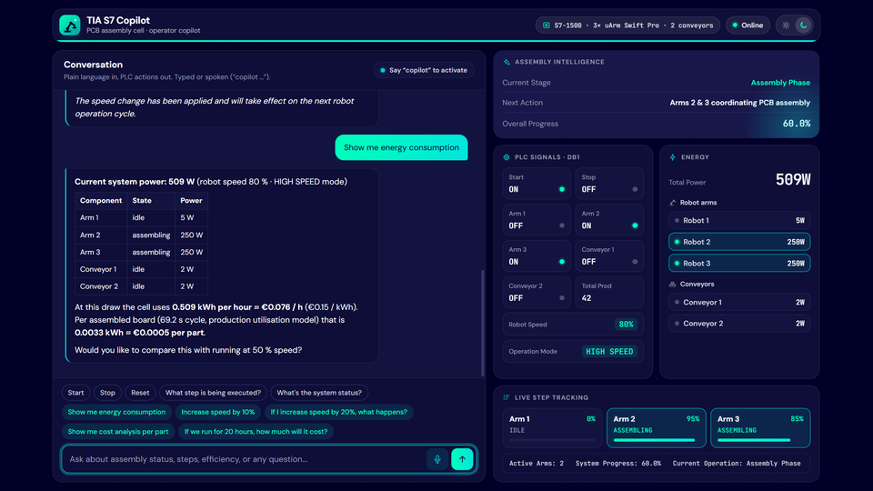
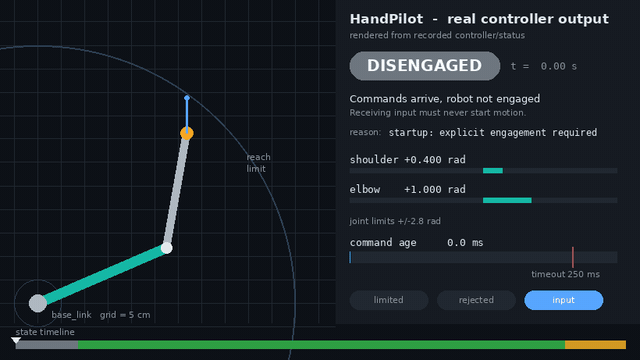
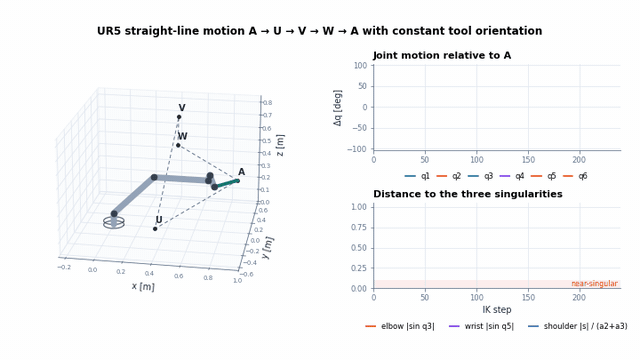
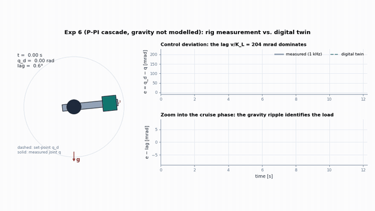
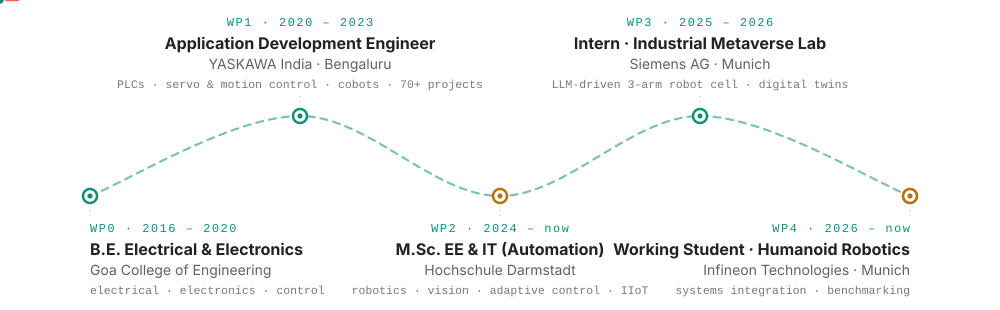

  <picture>
    <source media="(prefers-reduced-motion: reduce)" srcset="assets/banner-static.svg">
    
  </picture>

  
  
  

I'm Sahil, a robotics and automation engineer. I spent three years commissioning PLCs, servo drives and cobots at **YASKAWA**, built an LLM-driven three-arm robot cell and its digital twins at the **Siemens Industrial Metaverse Lab**, and now work on **humanoid robotics at Infineon** while finishing my M.Sc. in Automation at Hochschule Darmstadt.

One rule runs through everything below: **simulate it, measure it, then move the robot.** Most of these repositories pair a model or digital twin with real measurements (a 1 kHz test rig, a real UR5, a lab camera, a live PLC) and report the gap honestly.

**Focus:** robot kinematics & control · digital twins & sim-to-real · PLC & motion control · industrial AI

## Featured builds

<table>
<tr>
<td width="50%" valign="top">

<h3><a href="https://github.com/SahilMalwanker/morphlab-ai">MorphLab</a></h3>
<code>TypeScript</code> <code>React</code> <code>Three.js</code> <code>MuJoCo (WASM)</code>

A robotics lab that runs entirely in the browser. Build a robot from links and joints, explore its kinematics, simulate it with real physics, teach it skills, and command it through an AI that can only act via validated tools and always reports what it <i>measured</i>.

<b>"walk forward 40 cm" → 0.414 m measured</b> · 556 unit tests · <a href="https://morphlab-ai.vercel.app/"><b>▶ try it live</b></a>

</td>
<td width="50%" valign="top">

<h3><a href="https://github.com/SahilMalwanker/isaac-uarm-twin">Isaac uArm Twin</a></h3>
<code>NVIDIA Isaac Sim 5.x</code> <code>OpenUSD</code> <code>PhysX</code> <code>FastAPI</code>

A real-time, physics-driven digital twin of a three-arm PCB assembly cell. Live servo angles from three physical uArm Swift Pro robots drive calibrated PhysX joints, with closed-loop parallel linkages, conveyors and light-barrier sensors.

<b>120 Hz telemetry → 60 Hz physics</b> · 3 closed kinematic loops per arm · 196 tests

</td>
</tr>
<tr>
<td width="50%" valign="top">

<h3><a href="https://github.com/SahilMalwanker/tia-s7-copilot">TIA S7 Copilot</a></h3>
<code>S7-1500</code> <code>Snap7</code> <code>TIA Openness</code> <code>Azure OpenAI</code> <code>FastAPI</code>

Talk to a PLC-controlled robot cell. Operators type or say <i>"set speed to 80%"</i>: the LLM only classifies the request, Python checks, clamps and writes the PLC, and the arms follow. Stop words skip the model entirely.

<b>17 cycles, 0 sequence errors</b> · E-stop 5/5 · prompt size −72%

</td>
<td width="50%" valign="top">

<h3><a href="https://github.com/SahilMalwanker/handpilot">HandPilot</a></h3>
<code>ROS 2 Jazzy</code> <code>C++17</code> <code>Python</code> <code>Ubuntu ARM64</code>

Keyboard in, bounded robot motion out. A ROS-free C++ core handles FK, IK, limits and a latched safety state machine: nothing moves until the operator engages, and the arm holds when commands go quiet.

<b>watchdog HOLD after 250 ms</b> · 51 tests on ARM64 + x86_64 · CI

</td>
</tr>
<tr>
<td width="50%" valign="top">

<h3><a href="https://github.com/SahilMalwanker/ur5-singularity-atlas">UR5 Singularity Atlas</a></h3>
<code>Python</code> <code>NumPy</code> <code>robot kinematics</code>

Every way a UR5 can lose a degree of freedom, in closed form. det J factorises into elbow, wrist and shoulder terms. Three Jacobians agree to 1e-12, all eight IK branches are solved, and damped least squares tames the wrist flip.

<b>model vs. real robot: 10.7 → 2.8 mm RMS</b> · 96 tests

</td>
<td width="50%" valign="top">

<h3><a href="https://github.com/SahilMalwanker/harmonic-digital-twin">Harmonic Digital Twin</a></h3>
<code>Python</code> <code>model-based control</code> <code>system ID</code>

A digital twin of a harmonic-drive robot joint under computed-torque, P-PI and P-ReDuS control, checked against 1 kHz recordings from a real test rig. The tracking-error harmonic reveals the load that was really mounted.

<b>twin ≈ rig within 0.5 mrad RMS</b> · true load 14.3 kg found (model said 9.4 kg)

</td>
</tr>
</table>

## The robot stack, layer by layer

Every public repository, sorted by where it sits between photons and PLCs.

| Layer | Project | What it does |
| :-- | :-- | :-- |
| 👁️ **Perception** | [look-and-move](https://github.com/SahilMalwanker/look-and-move) | Image-based visual servoing of a 6-DoF arm from one overhead camera. A closed-form stability map predicts the arm still converges with an 85° camera-yaw error. |
| | [stereometry](https://github.com/SahilMalwanker/stereometry) | Stereo calibration, triangulation and dense SGBM depth, with explicit depth-error propagation. |
| | [featureforge](https://github.com/SahilMalwanker/featureforge) | Inspectable classical vision: lighting-aware blob measurement, Hough-vs-Harris cross-checks and rotation repeatability. |
| | [camera-noise-characterization](https://github.com/SahilMalwanker/camera-noise-characterization) | EMVA 1288 sensor twin and photon-transfer analysis of a real GigE camera. Two independent gain estimates agree within 2 %. |
| 🦾 **Kinematics & motion** | [ur5-singularity-atlas](https://github.com/SahilMalwanker/ur5-singularity-atlas) | Closed-form singularity atlas, 8-branch IK and tool calibration for the UR5. |
| | [handpilot](https://github.com/SahilMalwanker/handpilot) | ROS 2 Jazzy + C++17 bounded teleoperation with a latched HOLD/FAULT state machine. |
| | [morphlab-ai](https://github.com/SahilMalwanker/morphlab-ai) | Damped least-squares IK, manipulability ellipsoids, occupancy mapping, A* and pure pursuit, all in the browser. |
| 🎛️ **Control & dynamics** | [harmonic-digital-twin](https://github.com/SahilMalwanker/harmonic-digital-twin) | Model-based joint control validated against a 1 kHz rig. Velocity pre-control cuts the peak error 20×. |
| | [adapt-ctrl-sys-id](https://github.com/SahilMalwanker/adapt-ctrl-sys-id) | System identification and RLS adaptive control of a DC servo and a propeller pendulum, run against a TCP digital twin. Overshoot drops from 13.7 % to 3.8 % after a 1.85× inertia change. |
| | [state-space-studio](https://github.com/SahilMalwanker/state-space-studio) | Pole placement vs. PI state feedback vs. LQR across five plants, cross-checked in MATLAB/Simulink. |
| 🧪 **Simulation & digital twins** | [isaac-uarm-twin](https://github.com/SahilMalwanker/isaac-uarm-twin) | Live servo telemetry driving a three-arm cell in NVIDIA Isaac Sim. |
| | [ml-in-manufacturing](https://github.com/SahilMalwanker/ml-in-manufacturing) | Can a digital twin train a fault detector for the real press? 96.99 % accuracy on combined data, but only 48.47 % when trained on the twin alone: a sim-to-real lesson in numbers. |
| | [process-simulate-opc-ua-bridge](https://github.com/SahilMalwanker/process-simulate-opc-ua-bridge) | Drive any Tecnomatix Process Simulate study over OPC UA, with a strict handshake sequencer and 18 live joint angles. |
| 🏭 **Industrial integration** | [tia-s7-copilot](https://github.com/SahilMalwanker/tia-s7-copilot) | Natural-language and voice control of an S7-1500 cell with three uArm robots. |
| | [wincc-simatic-manufacturing-hmi](https://github.com/SahilMalwanker/wincc-simatic-manufacturing-hmi) | SIMATIC TP700 HMI from UML to TIA Portal V17: MANUAL/AUTO, recipes, alarms, user roles, EN/DE runtime. |
| | [industrial-edge-plc-log-analyzer](https://github.com/SahilMalwanker/industrial-edge-plc-log-analyzer) | Siemens KicksForEdge hackathon for Element Logic: Industrial Edge, Node-RED and OpenSearch analytics. The team's prototype cut a ~7-day manual log search to ~10 minutes. |

## Trajectory so far

  <picture>
    <source media="(prefers-color-scheme: dark)" srcset="assets/journey-dark.svg">
    
  </picture>

## Toolchain

  <picture>
    <source media="(prefers-color-scheme: dark)" srcset="assets/toolchain-dark.svg">
    
  </picture>

## Publication

**Electronic Camming for Dynamic Motion Control in Automated Systems**: *International Journal for Research in Applied Science & Engineering Technology (IJRASET)*, Vol. 12, Issue II, Feb 2024. How a follower axis can track a master through a digital cam table, so motion profiles change in software instead of in steel.

---

  Open to conversations about robotics, digital twins and industrial automation. Say hi on <a href="https://www.linkedin.com/in/sahil-malwanker">LinkedIn</a>. 
  <code>/sahil/status: IDLE · awaiting next command_</code>

